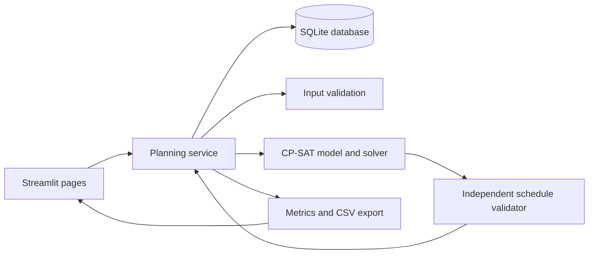

# Textile Production Optimization

A local planning tool that builds production schedules for textile plants. It decides which operation runs on which machine and when, so that orders finish on time and machines are used well.

## Overview

The tool takes your orders, due dates, machines, working hours and processing steps. It then produces a schedule that follows your rules, such as machine availability and the order of operations. Every schedule is checked by a separate validator before it is accepted.

It runs on a single computer. It needs no cloud service, no paid software and no special hardware.

> Status: version 0.1.0, early development. It has been tested only with synthetic data. See [Current Status](#current-status).

## Industrial Problem

A textile plant usually has many orders in progress at the same time. Each order passes through several steps, for example knitting, dyeing and finishing. Each step needs a suitable machine, and each machine can run only one job at a time.

Planners must balance several things together:

- Due dates for each order.
- Steps that must follow a fixed sequence.
- Machines that are busy, switched off or under maintenance.
- Time lost when a machine changes from one job type to another. In dyeing, going from a dark shade to a light shade usually needs more cleaning than the reverse.

Doing this by hand, or in a spreadsheet, is slow. A small change, such as a late order or a machine breakdown, can force the planner to redo much of the plan. It is also hard to know whether a plan is good or only acceptable.

## Proposed Solution

The tool turns the planning rules into a mathematical model and solves it with a constraint solver (Google OR-Tools CP-SAT). The solver searches for a schedule that respects every rule and gives the best result for the goal you choose.

The tool does not trust the solver blindly. A separate checker re-tests the finished schedule against the original rules. Only a schedule that passes this check is shown as valid.

The tool also reports honestly what it found:

- **Optimal:** the best possible result for the chosen goal was proven.
- **Feasible:** a valid schedule was found, but it was not proven to be the best.
- **Infeasible:** no schedule can satisfy all the rules within the planning period.

## Key Capabilities

**Data entry**
- Production orders with release time, due time, quantity, priority and weight.
- Machines with the processes they support, working hours and planned downtime.
- Operations with durations, allowed machines and required predecessors.
- Optional machine-specific durations, so the same step can take longer on a slower machine.
- Optional changeover times between job categories, such as dark to light shade.

**Scheduling**
- Chooses a machine and a start time for every operation.
- Keeps each operation inside the machine's available hours. Operations are not interrupted.
- Starts a step only after its predecessors have finished.
- Prevents two operations from using one machine at the same time.
- Offers three goals, one per run: shortest total completion time (makespan), lowest total lateness, or lowest weighted lateness.
- Can treat due dates as firm limits if you choose.

**Checking and results**
- Checks the input data and lists problems before any scheduling starts.
- Validates every schedule independently before accepting it.
- Shows a timeline chart by machine and a table of all operations.
- Reports late orders, completion times, machine utilization and total changeover time.
- Compares the result with a simple baseline schedule (earliest due date first) on the same data.
- Exports schedules and reports as CSV files.

**Record keeping**
- Saves every run with its input data, settings and result.
- Marks a saved schedule as out of date when the data or settings change afterwards.
- Keeps older runs for reference.
- Creates database backups from the dashboard.

## How It Works

1. **Input.** Enter machines, orders and operations in the application. A synthetic sample dataset can be loaded to try the tool.
2. **Check.** The tool tests the inputs. For example, it flags an operation that has no machine or an order that has no operations.
3. **Schedule.** You choose a goal and a time limit, then start the run. The solver builds a schedule.
4. **Validate.** An independent checker tests the schedule against all rules.
5. **Review.** You see the timeline, the operation table and the reports. You can download them as CSV.

Example: three orders need knitting and then dyeing. Two dyeing machines are available. The tool decides which order goes to which dyeing machine and in what order. It avoids unnecessary dark-to-light switches when changeovers are turned on.

## System Architecture



- **Streamlit pages** show the screens: Dashboard, Production Orders, Machines, Operations, Schedule and Reports.
- **Planning service** runs the workflow. It is the single place where checking, solving, validating and saving are connected.
- **SQLite database** stores all data and every schedule run in one local file.
- **Solver** builds the CP-SAT model from an immutable copy of the input data and runs it.
- **Schedule validator** shares no code with the solver. It re-checks the result from the input data.
- **Metrics and export** calculate lateness, completion and utilization, and write CSV files.

Time inside the system is counted in whole minutes from a planning start time that you set. The screens also show the calendar date and time.

## Technology Stack

| Technology | Purpose |
|---|---|
| Python 3.11 or newer (3.12 tested) | Main language |
| Google OR-Tools (CP-SAT) | Constraint solver |
| Streamlit | Web user interface that runs locally |
| SQLite | Local database, part of Python |
| Pydantic | Validation of entered data |
| pandas | Tables in the interface |
| Plotly | Timeline and utilization charts |
| pytest, Ruff | Testing and code style checks |

Exact package versions are in `requirements.txt` and `requirements-dev.txt`.

## Installation & Setup

### Prerequisites

- Python 3.12 (64-bit) is recommended. Python 3.11 or newer is required.
- Internet access once, to download the packages.

### Install and start (Windows, Command Prompt)

```bat
cd path\to\textile-production-optimization
py -m venv .venv
.venv\Scripts\activate
python -m pip install --upgrade pip
pip install -r requirements.txt
python -m streamlit run app.py
```

The application opens at http://localhost:8501. Stop it with `Ctrl+C`.

On Linux or macOS, use `python3 -m venv .venv`, then `source .venv/bin/activate`, and the same `pip` and `streamlit` commands.

### Configuration

No configuration is needed to start. The database file is created on first start at `data/textile_optimizer.db`. Two optional environment variables change the location:

| Variable | Meaning |
|---|---|
| `TPO_DATA_DIR` | Folder for the database, logs and backups |
| `TPO_DB_PATH` | Full path of the database file |

Logs are written to `data/logs/app.log`. The `data` folder content is excluded from Git.

### Run the tests

```bat
pip install -r requirements-dev.txt
python -m pytest
```

Performance checks and benchmarks are separate:

```bat
python -m pytest -m performance
python scripts\run_benchmarks.py --limit 10
```

## Usage

1. Open **Dashboard**, then **Data management**, and choose **Load synthetic sample data**. This works only when the database is empty. For your own data, skip this step.
2. Enter data in this order: **Machines**, then **Production Orders** (set the status to `ready`), then **Operations**.
3. Open **Schedule**. Under **Scheduling settings**, set the planning start, the planning period (horizon), the goal and the solver time limit. Turn on changeovers if you want them modelled, and fill in the changeover table.
4. Choose **Validate Inputs** and fix any listed errors.
5. Choose **Generate Schedule**. Wait for the solver to stop. There is no way to cancel a run once it has started.
6. Read the status label, the timeline and the table. Open **Reports** for lateness, utilization and the baseline comparison. Download CSV files if needed.

Notes:

- Only orders with status `ready` are scheduled. Draft orders are skipped with a warning.
- Due dates are targets by default. The tool minimizes lateness. Turn on "Enforce due dates as hard constraints" to make them firm limits. The run can then become infeasible.
- A schedule marked "out of date" was made before your latest change. Generate a new one.
- A longer time limit and more solver workers can improve results for larger problems.

## Project Structure

```
app.py                      Application entry point
src/textile_optimizer/
  domain/                   Data records, input snapshot, time and interval helpers
  validation/               Input checks and the independent schedule validator
  scheduling/               Solver model, solver runner, baseline schedule
  persistence/              SQLite schema and database access
  services/                 Workflow service and synthetic sample data
  reporting/                Metrics and CSV export
  ui/                       Screens, charts and shared interface parts
tests/                      Unit, scheduling, validation, integration, UI, regression, performance
scripts/                    Benchmark script
docs/                       Assumptions, test report, benchmark results, GitHub publishing notes
data/                       Local database and logs (not committed)
```

Further reading:

- [Assumptions and limitations](docs/ASSUMPTIONS_AND_LIMITATIONS.md)
- [Test report](docs/TEST_REPORT.md)
- [Benchmark results](docs/benchmark_results.md)

## Current Status

Version 0.1.0 is an early release.

**Implemented**
- All features listed under Key Capabilities.
- An automated suite of 208 tests. It passed in a clean installation on Linux with Python 3.12.3.

**Not verified**
- Installation and use on Windows have not been tested yet.
- The application has been used only with synthetic data. It has not been tested with real factory data.
- The appearance in a browser has not been reviewed beyond automated rendering tests.
- Solver speed on multi-core computers has not been measured.

**Known limits**
- Operation durations are entered values, often estimates. The tool does not calculate them from quantity or machine speed.
- Each machine runs one job at a time. Operations cannot be interrupted.
- There are no waiting times or overlaps between steps, and no limits on workers, tools or utilities.
- Changeover times are one global table by job category, not per machine.
- Only one goal can be optimized per run.
- Shifts, breaks and holidays must be entered as machine availability windows.
- The tool is for one local user. It has no login and no solver cancellation.
- On the synthetic benchmark, problems of about 20 orders (60 operations) reached the time limit with schedules that were valid but not proven best. See the benchmark results for details.

A valid schedule means the schedule satisfies the rules that the tool models. It does not guarantee that the plan works on the shop floor.

## Roadmap

These items are ideas for future work. None of them exist yet.

- Test the full workflow on Windows and with real plant data.
- Machine-specific changeover times.
- Calculation of durations from quantity and machine speed.
- Staged goals, for example lateness first and then completion time.
- Shift and holiday calendars.
- Ability to cancel a running solve.
- Better results on larger problems.

## Contributing

1. Create a virtual environment and run `pip install -r requirements-dev.txt`.
2. Read [docs/ASSUMPTIONS_AND_LIMITATIONS.md](docs/ASSUMPTIONS_AND_LIMITATIONS.md).
3. A new rule needs a written definition, a solver constraint, a check in the independent validator, and tests that include a failing case.
4. Run `python -m pytest`, `python -m ruff check .` and `python -m ruff format --check .` before you submit changes.
5. Do not commit real production data, databases, logs or credentials. Label any sample data as synthetic.

See [CONTRIBUTING.md](CONTRIBUTING.md).

## License

MIT License. See [LICENSE](LICENSE).
